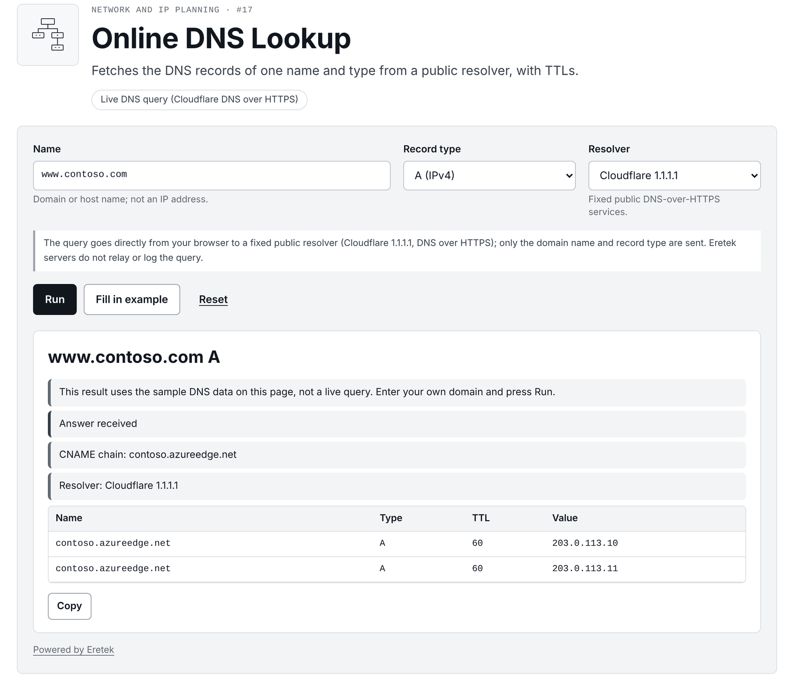

# DNS Lookup

Look up a domain's DNS records with TTL: A, AAAA, CNAME, MX, NS, TXT, SOA, CAA and SRV. NXDOMAIN, NODATA and SERVFAIL are shown separately.

## Try it live

- [Türkçe](https://network.eretek.com/araclar/dns-kayit-sorgulama)
- [English](https://network.eretek.com/en/tools/dns-lookup)
- [Deutsch](https://network.eretek.com/de/werkzeuge/dns-abfrage)



## What it does

Fetches the DNS records of one name and type from a public resolver, with TTLs.

To check whether a change has propagated, where a CNAME leads or whether a TXT verification record is visible, a command line is not always at hand. The tool queries one name for one record type and separates 'name does not exist' (NXDOMAIN) and 'name exists but no such type' (NODATA) from server errors.

## Where it helps

NODATA means the name exists but has no record of this type; you may have queried the wrong type. NXDOMAIN may be a typo or a record that has not propagated.

SERVFAIL usually comes from a DNSSEC signature error or an unreachable authoritative server; try the other resolver or use the DNS Resolver Comparison.

## How to use it

1. Enter the name to query (`www.contoso.com`, `_sip._tls.contoso.com`).
2. Choose the record type and resolver and press Run.

### Fields

| Field | Description |
|---|---|
| Name | Domain or host name; not an IP address. |
| Record type |  |
| Resolver | Fixed public DNS-over-HTTPS services. |

## Example input

Press **Fill in example** in the tool to load this input.

| Input | Value |
|---|---|
| Name | `www.contoso.com` |
| Record type | `A (IPv4)` |
| Resolver | `Cloudflare 1.1.1.1` |

**Expected result:** www.contoso.com is a CNAME to contoso.azureedge.net; two A records (203.0.113.10 and .11), TTL 60 seconds.

## Method and assumptions

The query goes from your browser directly to the chosen resolver's DNS-over-HTTPS JSON interface; no Eretek server is involved. CNAME chains are shown separately; quoted TXT segments are joined within one record.

States: NOERROR with records (answer), NOERROR without records (NODATA), NXDOMAIN (no such name), SERVFAIL (authoritative or DNSSEC failure), timeout and rate limit.

## Limits and common mistakes

- It does not query the authoritative server directly; it shows the public resolver's cached answer.
- Only the listed record types are supported.

## Run it locally

The tool is plain HTML, CSS and JavaScript with no build step and no dependencies.

```bash
git clone https://github.com/eretek/dns-lookup.git
cd dns-lookup
node scripts/serve.js        # or: python3 -m http.server 8080
```

Open <http://127.0.0.1:8080/>. Add `?lang=tr` or `?lang=de` for Turkish or German; without it the page follows the browser language and falls back to English. You can also open `index.html` directly from disk.

Run the tests (Node.js 18 or later):

```bash
node test/run.js    # or: npm test
```

The tests run the tool's own fixtures and the worked examples in all three languages without a browser.

## How it works

Everything except the DNS lookup runs in your browser. The lookup goes directly from the browser to a fixed public DNS-over-HTTPS resolver (Cloudflare `cloudflare-dns.com`, with Google `dns.google` as the second resolver in `src/lib/dns.js`); only the domain name and record type are sent. The **Fill in example** button uses sample DNS data stored in `src/data.js`, not a live query.

No server-side component is needed. The version on the Eretek website renders the same page through a private WordPress plugin; that plugin only produces the page markup and is not part of this repository.

| Path | Purpose |
|---|---|
| `index.html` | Page shell |
| `src/app.js` | Builds the page in Turkish, English or German from `src/data.js` |
| `src/data.js` | Field definitions, examples and all texts in three languages |
| `src/core.js` | Shared runtime: validation, number formats, result rendering, CSV/ICS export |
| `src/tool.js` | The calculation or analysis for this tool |
| `docs/screenshot.png` | Screenshot used in this README |
| `src/lib/dns.js` | DNS-over-HTTPS client for fixed public resolvers |
| `src/tools.css`, `src/page.css` | Styles |
| `test/run.js`, `test/cases.json` | Headless tests |

## License and attribution

This tool is released under the [Eretek Website Attribution License](LICENSE). You may use, modify and redistribute it, including commercially. If you make it available on a website or web application, show a visible, clickable credit linking to https://eretek.com/ on every page where the tool is available, for example:

```html
<a href="https://eretek.com/">Powered by Eretek</a>
```

You may add `rel="nofollow"` to the link. Keep the copyright notice and license text in copies and redistributions.
